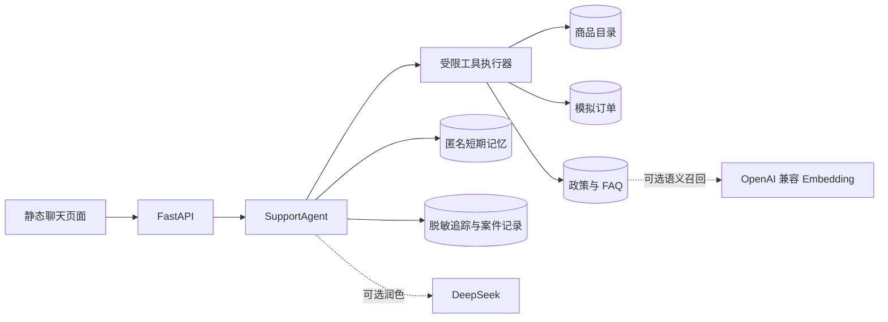

# ClickyCanvas · 可解释的电商客服 AI Agent

ClickyCanvas 是一个中文优先、可本地运行的电商客服 Agent 原型。它把**商品推荐、政策问答、模拟订单查询和售后转人工**接成一条可验证的服务闭环，重点解决“模型会聊天，但事实、边界和评估说不清”的问题。

> **快速体验入口**：启动 Demo → 输入一条商品推荐问题 → 追问一个条件 → 查询模拟订单 → 触发一次售后转人工 → 查看下面的评测指标和架构取舍。

## 这个项目展示什么

- **结构化事实优先**：商品价格、规格、兼容性和订单状态来自本地结构化数据，模型不能直接改写业务事实。
- **受限工具型 Agent**：商品搜索、商品详情、商品对比、政策检索、订单查询和售后建案都有明确工具边界，单轮最多执行 3 次工具调用。
- **可解释的检索**：政策和 FAQ 先走本地词法检索；配置 embedding 后可启用词法 + 语义的 Hybrid RAG，异常时回退到词法结果。
- **短期会话记忆**：匿名选购条件按 `conversation_id` 保存 24 小时，支持清除；它不是永久用户画像，也不保存真实身份或订单验证码。
- **高风险场景转人工**：退款争议、商品损坏、严重安全问题和政策例外不会由模型直接承诺处理结果。
- **评测先于上线叙事**：固定回归、独立挑战、商品选购评估、政策检索指标和人工盲评都保存在仓库中。

这是一个**演示型原型**：商品、订单、政策和售后案件均为虚构数据，不会真实收款、发货、退款或连接人工客服系统。

## 功能体验路径

启动本地服务后，在运行服务的电脑上访问 `http://127.0.0.1:8000`，可以按下面顺序操作。这个地址是本机回环地址，GitHub 访客无法直接打开；如需在线体验，需要另外部署并提供公开网址：

| 步骤 | 输入示例 | 可观察行为 |
| --- | --- | --- |
| 商品推荐 | `有没有适合办公室、声音比较小的键盘？` | 从结构化目录筛选候选，并说明匹配条件 |
| 条件追问 | `预算 800 以内，最好支持 Mac` | 上一轮的匿名选购条件被保留并收敛候选 |
| 政策问答 | `键盘进水后还能走保修吗？` | 从 FAQ/政策片段回答，资料不足时不猜测 |
| 订单查询 | `订单 CC-1002 到哪了？验证码 1937` | 订单号和演示验证码校验后返回物流轨迹 |
| 高风险售后 | `订单 CC-1006 到货损坏，我要退款` | 创建本地售后案件，停止自动承诺退款 |

页面里的“查看回答依据”和“当前数据来源”可以快速核对回答来自哪里、哪些数据仍是演示数据。

## 架构一览



核心取舍是让**确定性代码掌握事实、路由和安全边界**，让可选模型只在证据已经确定后润色表达。这样可以把“回答错了”拆成需求理解、候选召回、排序、事实引用或话术问题，而不是只看一个总分。

## 本地运行

需要 Python 3.11+。

```powershell
python -m venv .venv
.\.venv\Scripts\Activate.ps1
python -m pip install -r requirements.txt
Copy-Item .env.example .env
python -m uvicorn app.main:app --reload
```

默认 `LLM_MODE=deterministic`，不需要外部 API Key，也不会发起模型请求。配置 DeepSeek 或 embedding 时，只把真实 Key 写在本地 `.env`；`.env` 已被 Git 忽略，仓库只保留 [`.env.example`](.env.example) 模板。

## 可验证结果

以下结果来自仓库内的固定虚构数据和本地评估脚本，完整解释见 [`docs/p6.7_metrics_story.md`](docs/p6.7_metrics_story.md)：

| 评估 | 结果 | 说明 |
| --- | ---: | --- |
| 固定 holdout | 33/33 案例通过 | 39 个对话轮次；硬条件违反率 0% |
| 售前商品评估 | 58/58 | 覆盖需求理解、召回、排序和回答 |
| 综合演示评估 | 84/84 | 商品、政策、订单、售后和边界场景 |
| 独立挑战集 | 96.7% 案例通过 | 60 个案例、70 个轮次；安全边界违规 0 |
| deterministic P95 | 11.75 ms | 本地基线，不代表生产 SLA |

运行本地检查：

```powershell
$env:LLM_MODE = "deterministic"
$env:EMBEDDING_API_KEY = ""
python -m pytest -q tests/test_catalog_import.py tests/test_emotion.py tests/test_evaluation.py tests/test_holdout.py tests/test_memory.py tests/test_retrieval.py tests/test_shopping.py tests/test_tools.py
python scripts/evaluate_demo.py
python scripts/evaluate_shopping.py
python scripts/evaluate_retrieval.py --json
```

上面的测试命令覆盖核心目录、路由、检索、选购、工具和评估回归；API 首页和健康检查也可以在服务启动后按 `http://127.0.0.1:8000/health` 验证。

评测数字只说明覆盖到的本地行为符合预期，不能证明真实用户满意度、线上转化率、生产 SLA 或跨商家泛化能力。

## 数据与隐私边界

- `data/catalog.json`、`data/orders.json` 和 `data/knowledge/` 是虚构演示数据。
- 订单验证码只用于本地演示，写入追踪前会脱敏。
- `.env`、虚拟环境、SQLite 数据库、日志和运行时快照不会进入 Git。
- [`.env.example`](.env.example) 只包含空 Key 和公开的示例配置。
- 项目不包含真实客户资料、真实订单、支付信息或生产凭据。

## 项目结构

```text
app/       FastAPI、Agent、工具、检索、模型和数据库实现
data/      虚构商品、订单、政策 FAQ 和评估案例
docs/      产品规格、架构取舍、评估报告和维护说明
scripts/   目录导入、快照同步和评估命令
static/    单页聊天 Demo
tests/     目录、Agent、API、检索和边界回归测试
```

## 主要 API

```text
GET    /health
GET    /api/data-sources
GET    /api/products?query=静音&max_price=800
GET    /api/products/{product_id}
POST   /api/products/compare
POST   /api/orders/lookup
POST   /api/chat
GET    /api/cases
GET    /api/traces?conversation_id=...
DELETE /api/conversations/{conversation_id}
```

更多材料：

- [`docs/PROJECT_SPEC.md`](docs/PROJECT_SPEC.md)：产品范围和明确暂缓项
- [`docs/ai_product_architecture.md`](docs/ai_product_architecture.md)：Hybrid RAG、会话记忆和 Agent 边界
- [`docs/shopping_capabilities.md`](docs/shopping_capabilities.md)：售前能力与评估边界
- [`docs/catalog_import.md`](docs/catalog_import.md)：商品目录导入格式和校验规则

## 诚实边界

ClickyCanvas 目前是一个用于产品思考、工程实现和评测方法展示的 AI Agent 原型。它没有接入真实店铺、支付、库存、账号体系或人工客服平台；所有“订单”和“售后案件”只写入本地演示数据库。
