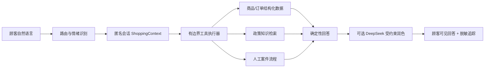

# ClickyCanvas AI 客服 Agent：架构取舍页

版本：P6.7 面试版｜日期：2026-10-11

## 1. 请求链路

## 2. 核心取舍

| 决策 | 选择 | 原因 | 牺牲/边界 |
| --- | --- | --- | --- |
| 事实来源 | 结构化商品/订单 + 本地政策知识库 | 商品价格、订单状态和政策边界可复核 | 暂不支持真实商家实时数据 |
| 回答生成 | deterministic 先出事实，DeepSeek 可选润色 | 防止模型改写价格、规格和案件结论 | 语言灵活性低于完全自由生成 |
| RAG | 词法基线 + 可选 embedding 混合召回 | 先可运行，再用 Top-k/MRR 评估语义收益 | embedding 不可用时回退词法，不能宣称线上效果 |
| 记忆 | 匿名会话 24 小时保存 ShoppingContext | 记住预算、用途、上一轮候选，降低重复追问 | 不是长期画像，不跨设备，不保存原始聊天 |
| Agent 工具 | 6 类工具，单轮最多 3 次 | 工具调用可审计、可限流，模型不能直接写事实 | 复杂任务需要拆分，暂不接真实交易 |
| 高风险处理 | 规则优先转人工 | 避免退款、赔偿和安全问题被模型越权处理 | 自动化率会降低，需要人工承接 |

## 3. 为什么不直接让一个模型回答

单模型直出会把事实检索、业务路由、情绪话术和安全决策混在一起，难以判断错误来自哪里，也容易出现无依据承诺。当前设计把“事实正确性”和“语言自然度”拆开：工具和确定性逻辑负责可验证事实，模型只在允许范围内改善表达。

## 4. 当前 Agent 边界

它是一个边界清晰的工具型 Agent：能理解上下文、选择工具、保留会话条件、依据结果组织下一步；它不是能自主修改订单、退款或执行外部交易的自治系统。

